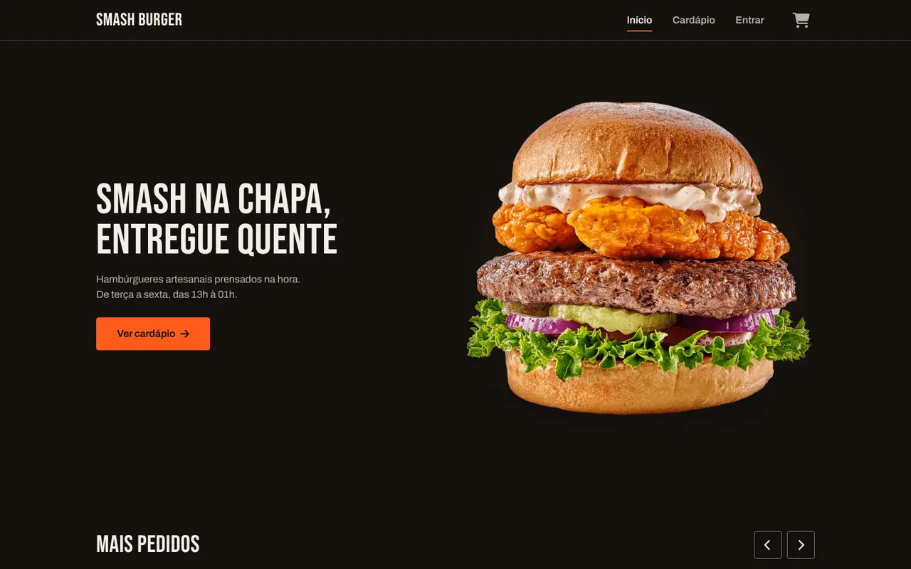
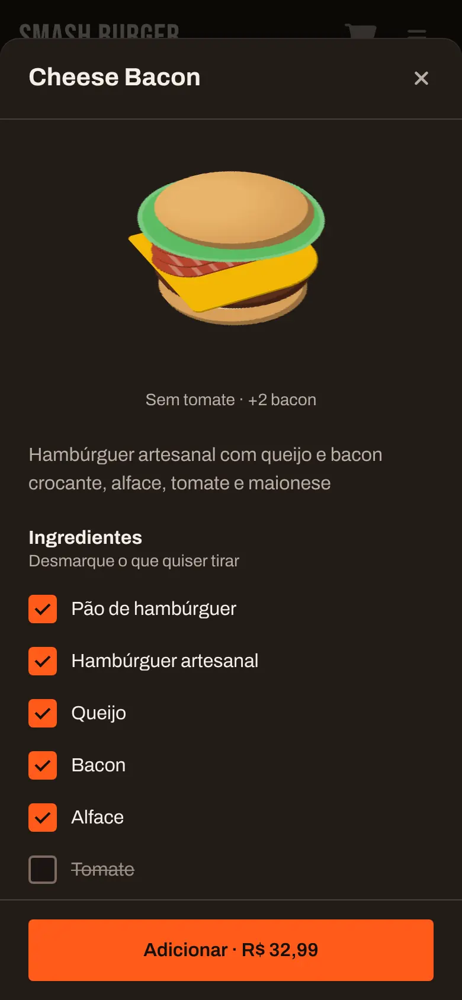
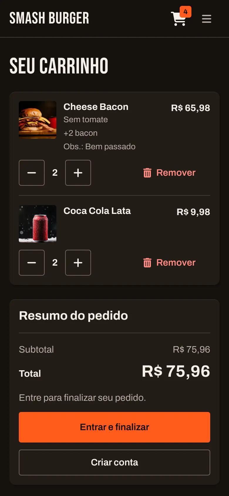
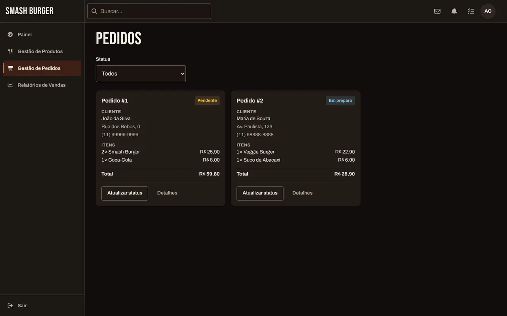

# Smash Burger

[](https://github.com/ldickmann/smash-burguer/actions/workflows/deploy.yml)

Front-end de delivery de hambúrgueres artesanais feito em Vue 3, com:

- cardápio com personalização do lanche;
- carrinho e checkout;
- conta do cliente com histórico de pedidos;
- painel administrativo.

É um projeto de portfólio sem back-end. Contas, carrinho e pedidos ficam no `localStorage` do navegador, e login e pagamento são simulados.

**Demonstração:** [ldickmann.github.io/smash-burguer](https://ldickmann.github.io/smash-burguer/)

<p align="center">
  
</p>
<p align="center">
  
  
</p>

## Funcionalidades

### Loja

- **Cardápio** com abas Hambúrgueres, Bebidas e Sobremesas. Os produtos ficam em `src/json/products.json`, e a Home destaca os hambúrgueres no carrossel "Mais pedidos".
- **Personalizar** abre um modal antes de o item entrar no carrinho:
  - nos hambúrgueres e na sobremesa, dá para tirar ingredientes e somar adicionais (até 5 de cada), com o preço recalculado na hora;
  - nos hambúrgueres, um montador 3D mostra as camadas do lanche;
  - nas bebidas, escolhe-se a quantidade (1 a 10);
  - em todos, há um campo de observação de até 140 caracteres.
- **Carrinho:**
  - quantidade de 1 a 10 por item;
  - remover com a opção "Desfazer" por 5 segundos;
  - resumo com subtotal e total.
- **Conta:**
  - cadastro com o endereço preenchido a partir do CEP, pela [API ViaCEP](https://viacep.com.br/);
  - login (quem entra pelo carrinho volta direto para o checkout);
  - perfil com edição dos dados e histórico de pedidos.
- **Checkout:**
  - usa o endereço da conta;
  - formas de pagamento: cartão de crédito ou débito na entrega, PIX ou dinheiro;
  - termina numa confirmação com o número do pedido.

### Painel administrativo (protótipo)

Fica em `#/admin/login` e tem quatro telas:

- **Painel:** indicadores de venda.
- **Produtos:** criar e editar produtos.
- **Pedidos:** lista com filtro por status.
- **Relatórios.**

Os números e os pedidos são dados de exemplo; veja as [limitações conhecidas](#limitações-conhecidas).

<p align="center">
  
</p>

### Interface

- **Design system "Brasa":** tema escuro com tokens de cor, tipografia, espaçamento e movimento em SCSS, nas fontes Archivo e Bebas Neue. A especificação está em [SPEC.md](./SPEC.md).
- **Acessibilidade**, verificada com o axe-core (nenhuma violação WCAG 2.2 AA em 20 telas e estados, em 1440 e 390 px):
  - navegação completa por teclado, foco visível e link "Pular para o conteúdo";
  - diálogos que prendem e devolvem o foco;
  - avisos lidos por leitores de tela;
  - botões com área de toque de 44 px.
- **Micro-interações 3D só com CSS:** o botão "Adicionar" gira, o contador do carrinho anima e o card inclina com o mouse. Com `prefers-reduced-motion`, viram transições de opacidade.
- **Imagens:** WebP responsivas com `<picture>` e `srcset`. A Home carrega menos de 1 MB no celular.

## Tecnologias

| Tecnologia | Uso |
|---|---|
| [Vue 3](https://vuejs.org/) | Interface, com Composition API e `<script setup>` |
| [Vue Router 4](https://router.vuejs.org/) | Rotas com hash (`#/menu`), que funcionam no GitHub Pages |
| [Pinia](https://pinia.vuejs.org/) + [pinia-plugin-persistedstate](https://prazdevs.github.io/pinia-plugin-persistedstate/) | Estado do carrinho, da sessão e do painel, salvo no `localStorage` |
| [Vite 6](https://vite.dev/) | Servidor de desenvolvimento e build |
| [Sass](https://sass-lang.com/) | Estilos, tokens de design e mixins |
| [vue3-carousel](https://github.com/ismail9k/vue3-carousel) | Carrossel da Home |
| [Font Awesome 6](https://fontawesome.com/) | Ícones |
| [Fontsource](https://fontsource.org/) | Fontes Archivo e Bebas Neue servidas pelo próprio site |
| [ViaCEP](https://viacep.com.br/) | Endereço a partir do CEP |
| [Vitest](https://vitest.dev/) + [Vue Test Utils](https://test-utils.vuejs.org/) + [jsdom](https://github.com/jsdom/jsdom) | Testes unitários |
| [ESLint](https://eslint.org/) + [Prettier](https://prettier.io/) | Lint e formatação |
| [GitHub Actions](https://docs.github.com/actions) + [GitHub Pages](https://pages.github.com/) | Deploy |

## Como rodar localmente

### Pré-requisitos

- [Node.js](https://nodejs.org/) 22, a mesma versão do deploy.
- Yarn 3.8.7, ativado pelo Corepack, que já vem com o Node. A versão está fixada no `package.json`. Não use o Yarn 1: o `yarn.lock` está no formato do Yarn 3.

### Passo a passo

```bash
git clone https://github.com/ldickmann/smash-burguer.git
cd smash-burguer
corepack enable       # passa a usar a versão do Yarn definida no projeto
yarn install
yarn dev
```

Abra <http://localhost:5173/smash-burguer/>. O caminho `/smash-burguer/` vem do `base` do `vite.config.js`.

### Acessar o painel administrativo

O login do painel compara o e-mail e a senha com um administrador salvo no `localStorage`. Para criar esse administrador de teste:

1. Com o `yarn dev` rodando, abra <http://localhost:5173/smash-burguer/createAdmin.html>. A página apaga os dados salvos do site (carrinho, sessão e cadastro), cria o administrador e mostra o e-mail e a senha.
2. Entre em <http://localhost:5173/smash-burguer/#/admin/login>. O link que a página mostra aponta para `/admin/login`, endereço que não existe neste projeto.

O `createAdmin.html` não vai para o site publicado. Na demonstração online, o painel só abre se o administrador for criado à mão no `localStorage`.

## Scripts

| Comando | O que faz |
|---|---|
| `yarn dev` | Servidor de desenvolvimento em <http://localhost:5173/smash-burguer/>. O Vue DevTools fica em `/smash-burguer/__devtools__/`. |
| `yarn build` | Build de produção em `dist/` |
| `yarn preview` | Serve o build em <http://localhost:4173/smash-burguer/> |
| `yarn test:unit` | Vitest em modo observação. Para rodar uma vez: `yarn test:unit --run` |
| `yarn test:coverage` | Testes com relatório de cobertura em `coverage/` |
| `yarn lint` | ESLint, já corrigindo o que for automático (`--fix`) |
| `yarn format` | Prettier em `src/`. Boa parte do código ainda não segue o `.prettierrc.json`, então o comando reformata dezenas de arquivos. Se for rodar, faça isso num commit separado. |

## Estrutura do projeto

```text
.
├── .claude/e2e/          # verificação no navegador (Playwright + axe-core)
├── .github/workflows/    # deploy no GitHub Pages
├── docs/screenshots/     # imagens deste README
├── public/images/        # fotos do cardápio, fundos, ícones e manifest
├── src/
│   ├── __tests__/        # testes unitários (Vitest)
│   ├── assets/
│   │   ├── main.scss     # estilos globais: só a base
│   │   └── styles/       # base/ (tokens, breakpoints, movimento), components/, layouts/, pages/
│   ├── components/       # componentes da loja
│   │   ├── ui/           # componentes base (BaseButton, BaseDialog, AppToast…)
│   │   ├── layout/       # navbar e rodapé
│   │   └── admin/        # componentes do painel
│   ├── composables/      # lógica reutilizável (imagens, tilt, CEP, validação…)
│   ├── handlers/         # fluxo de login e cadastro
│   ├── json/             # cardápio (products.json)
│   ├── layouts/          # MainLayout (loja) e AdminLayout (painel)
│   ├── plugins/          # registro dos ícones do Font Awesome
│   ├── router/           # rotas, guards, título da página e foco
│   ├── services/         # autenticação simulada do cliente e do administrador
│   ├── stores/           # Pinia: carrinho, sessão, produtos, admin e avisos
│   ├── utils/            # preço, máscaras, validações e dados de exemplo do painel
│   └── views/            # páginas da loja, auth/ e admin/
├── AUDIT.md              # auditoria de UI/UX que deu origem ao redesign
├── SPEC.md               # especificação do redesign "Brasa"
├── TESTING.md            # testes
├── CLAUDE.md             # orientações para o Claude Code
└── createAdmin.html      # cria o administrador de teste (só em desenvolvimento)
```

## Dados no navegador

Sem back-end, o estado fica no `localStorage`, nestas chaves:

| Chave | Conteúdo |
|---|---|
| `smash-burger:cart:v1` | Itens do carrinho |
| `smash-burger:session` | Sessão do cliente, histórico de pedidos e número do próximo pedido |
| `smash-burger:account` | Cadastro do cliente |
| `admin` | Administrador de teste e sessão do painel |

Para recomeçar do zero, apague os dados do site nas ferramentas do navegador.

## Testes

Há 35 testes unitários, em 5 arquivos, cobrindo `BaseButton`, `AppToast`, `BannerComponent`, o carrinho e a autenticação. O que cada um cobre, como rodar e a verificação no navegador estão em [TESTING.md](./TESTING.md).

## Deploy

Todo push na `main` dispara o workflow [`deploy.yml`](./.github/workflows/deploy.yml), que:

1. instala as dependências com `yarn install --immutable` (Node 22);
2. gera o build;
3. publica a pasta `dist/` no GitHub Pages.

Para publicar um fork com outro nome de repositório, ajuste o `base` no `vite.config.js`.

## Documentação de design

- [AUDIT.md](./AUDIT.md): auditoria de UI/UX da versão anterior, com os achados numerados (ex.: `[FLX-09]`).
- [SPEC.md](./SPEC.md): especificação do redesign "Brasa": tokens, componentes, telas, micro-interações e critérios de aceite.

## Limitações conhecidas

- **Sem back-end:** contas, pedidos e cardápio existem só no navegador de cada pessoa.
- **Senhas em texto puro:** o cadastro e a sessão guardam a senha em texto puro no `localStorage`. Use dados fictícios.
- **Pagamento simulado:** nenhuma cobrança é feita.
- **Painel administrativo:**
  - indicadores, relatórios e pedidos são dados de exemplo;
  - produtos criados ou editados somem ao recarregar a página;
  - "Excluir" não remove o produto;
  - "Atualizar status" dá erro ([FLX-09](./AUDIT.md)).
- **Login do administrador:** o cadastro do admin e a sessão do painel usam a mesma chave `admin`. Depois de sair, rode o `createAdmin.html` de novo para entrar.
- **CEP:** a busca depende da API pública ViaCEP.

## Próximos passos

- [ ] API e banco de dados para contas, pedidos e cardápio
- [ ] Integração com um gateway de pagamento
- [ ] Painel administrativo com dados reais e status de pedido funcionando
- [ ] Notificações do andamento do pedido em tempo real
- [ ] Mais testes (utilitários, rotas, telas) e verificação no navegador no CI

## Como contribuir

1. Crie um branch a partir da `develop` atualizada, por exemplo `feature/nome-da-mudanca` ou `fix/nome-do-problema`. Quem não é do projeto deve fazer um fork.
2. Escreva os commits em português, no padrão [Conventional Commits](https://www.conventionalcommits.org/pt-br/), por exemplo `feat(carrinho): ...`, `fix(fluxo): ...` ou `docs: ...`.
3. Antes do pull request, rode `yarn lint`, `yarn test:unit --run` e `yarn build`.
4. Abra o pull request para a `develop`. A `develop` vai para a `main` por outro pull request. Use "Create a merge commit" para os dois branches manterem os mesmos commits.

## Autor

**Lucas Elias Dickmann**: [LinkedIn](https://www.linkedin.com/in/lucas-dickmann) · [GitHub](https://github.com/ldickmann)
