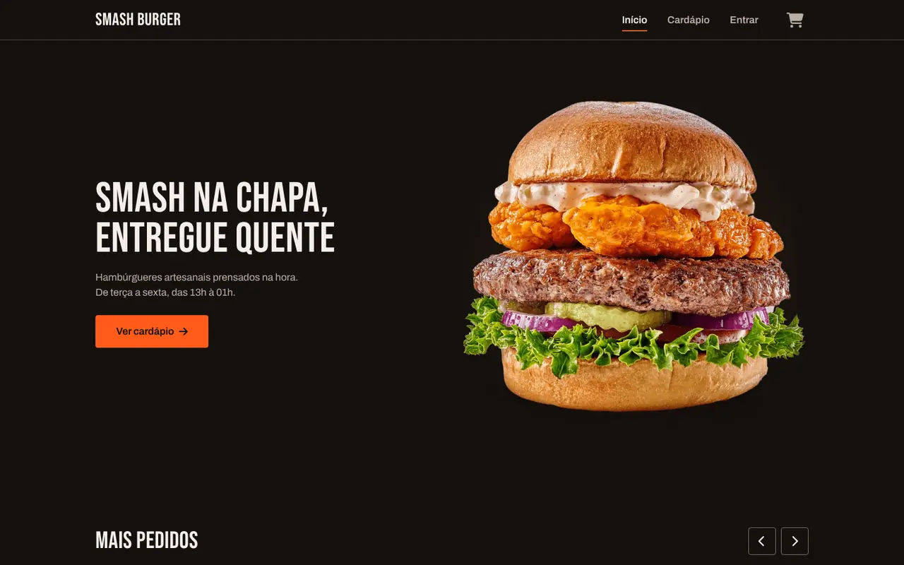
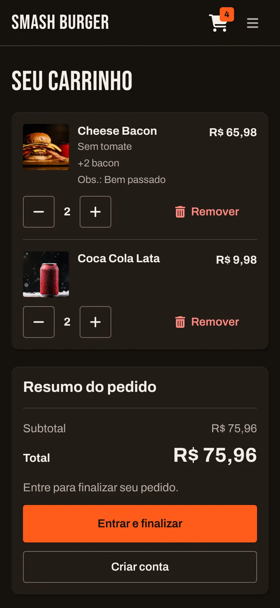

# Smash Burger

[](https://github.com/ldickmann/smash-burguer/actions/workflows/deploy.yml)

Front-end de delivery de hambúrgueres artesanais feito em Vue 3, com:

- cardápio com personalização do lanche;
- carrinho e checkout;
- conta do cliente com histórico de pedidos;
- painel administrativo.

É um projeto de portfólio sem back-end. Contas, carrinho e pedidos ficam no `localStorage` do navegador, e login e pagamento são simulados.

**Demonstração:** [ldickmann.github.io/smash-burguer](https://ldickmann.github.io/smash-burguer/)

<p align="center">
  
</p>
<p align="center">
  
  
</p>

## Funcionalidades

### Loja

- **Cardápio** com as categorias Hambúrgueres, Bebidas e Sobremesas. Os produtos ficam em `src/json/products.json`, e a Home mostra todos os hambúrgueres num feed, com o Smash Burger em destaque, os adicionais de lanche e de sobremesa com o acréscimo de cada um, e as bebidas e as sobremesas numa lista, cada produto com o botão de adicionar.
- **Personalizar** abre um modal antes de o item entrar no carrinho:
  - nos hambúrgueres e na sobremesa, dá para tirar ingredientes e somar adicionais (até 5 de cada), com o preço recalculado na hora;
  - nos hambúrgueres, um montador 3D mostra as camadas do lanche;
  - nas bebidas, escolhe-se a quantidade (1 a 10);
  - em todos, há um campo de observação de até 140 caracteres.
- **Carrinho:**
  - quantidade de 1 a 10 por item;
  - remover com a opção "Desfazer", que fica no aviso até a pessoa usá-la, fechar o aviso ou sair do carrinho (com uma nova remoção, o "Desfazer" anterior fica mais 10 segundos);
  - resumo com subtotal e total.
- **Conta:**
  - cadastro com o endereço preenchido a partir do CEP, pela [API ViaCEP](https://viacep.com.br/). Num CEP que vale para a cidade toda (sem rua), a pessoa informa a rua e o bairro;
  - celular e CEP com máscara durante a digitação, data de nascimento conferida no calendário (nada no futuro) e e-mail com `+` aceito;
  - a senha é guardada como hash PBKDF2, e não em texto;
  - login (quem entra pelo carrinho volta direto para o checkout, e quem abre o perfil sem sessão volta para ele);
  - perfil com edição dos dados (com as mesmas validações do cadastro), histórico de pedidos, que continua depois de sair, e exclusão da conta.
- **Checkout:**
  - usa o endereço da conta;
  - formas de pagamento: cartão de crédito ou débito na entrega, PIX ou dinheiro;
  - termina numa confirmação com o número do pedido.

### Painel administrativo (protótipo)

Fica em `#/admin/login` e tem estas telas:

- **Painel:** indicadores de venda.
- **Produtos:** criar, editar e excluir produtos (com confirmação). O formulário confere os campos e aceita só imagens PNG, JPEG e WebP de até 300 kB. O cardápio editado fica salvo neste navegador.
- **Pedidos:** lista com filtro por status, botão para avançar o status e "Detalhes" do pedido num diálogo. O status fica salvo neste navegador. A barra do painel conta os pedidos pendentes e em preparo e leva à lista já filtrada.
- **Relatórios.**
- **Busca** na barra do painel: filtra Produtos (nome e descrição) e Pedidos (número, cliente e itens), sem diferença de acento. Nas outras telas, o Enter leva a Produtos.
- **Meu perfil** e **Configurações**, no menu do avatar. Configurações restaura o cardápio original e os pedidos de exemplo.

Os indicadores, os relatórios e os pedidos iniciais são dados de exemplo; veja as [limitações conhecidas](#limitações-conhecidas).

<p align="center">
  
</p>

### Interface

- **Design system em migração para o Material 3 Expressive:** os tokens de cor, tipografia, forma, elevação e movimento já são os papéis do M3, no esquema claro gerado da semente verde-alface `#5DBB63` e na fonte Roboto. A regra base dos títulos (`h1` a `h3`) segue a escala tipográfica do M3, e o anel de foco tem 3 px; os títulos que as telas estilizam por conta própria passam ao M3 na etapa de cada tela. O `BaseButton` já desenha os botões do M3 (filled, tonal e de texto, com a troca de forma ao pressionar e o retorno "Adicionado"), e a Home de `#/` já é a do M3, igual à de referência: o hero com a "prensa" (o disco de 12 lobos que se achata uma vez na entrada, só com o movimento liberado), o feed "Hambúrgueres" com o Smash Burger em destaque e a folha de ingredientes no botão dividido de cada card, os adicionais de lanche e de sobremesa em chips, com o acréscimo de cada um, bebidas e sobremesas numa lista segmentada e o horário e contato. Os componentes dela ficam em `src/components/home/` e `src/components/ui/`. O Cardápio e o modal Personalizar também já são do M3: o título direto na superfície, sem a foto atrás; as categorias num grupo conectado, com a marcada em verde; a grade com os cards do feed; e, no modal, o montador do burger sobre um prato, os ingredientes em linhas de checkbox e os adicionais numa lista segmentada. O carrinho, o pagamento e a confirmação também: os itens do carrinho numa lista segmentada, com a miniatura na forma que o produto tem na Home, e o resumo num contêiner tonal que fica à vista a partir de 1024 px; no pagamento, a entrega e a forma de pagamento em contêineres, com as formas numa lista de opções em que a marcada muda de forma e ganha o check; e, na confirmação, uma faixa verde com o número e a forma do pedido, colada ao resumo. O login, o cadastro e o perfil também: o painel tonal com os campos de contorno e o rótulo acima, a senha com o botão de mostrar, o erro de envio junto do botão e, no perfil, os dados e os pedidos em contêineres, com o histórico numa lista segmentada. A moldura da loja já é a do M3, em todas as rotas: o cabeçalho com a marca; a toolbar com Início, Cardápio e Entrar (ou Perfil) numa pílula e o botão do carrinho com o contador, que no celular e no tablet flutua no canto de baixo e a partir de 1024 px fica no cabeçalho fixo; e o rodapé, que fora da Home mostra também horário, endereço, WhatsApp e e-mail. Os componentes base também são do M3: o aviso é o snackbar escuro no pé da tela, que não some sozinho quando tem uma ação ou é de erro e espera um diálogo aberto fechar para aparecer; o diálogo é tonal e, no celular, vira uma folha na altura do conteúdo; as confirmações de exclusão abrem com o foco no "Cancelar"; o estado vazio fica alinhado ao início; o seletor de quantidade usa dois botões redondos, que continuam focáveis no limite; e o botão de perigo, o botão de ícone, o carregando e o desabilitado seguem o M3. Os nomes antigos ficam como apelidos até o fim da migração. As telas ainda têm a estrutura do design system "Brasa" ([SPEC.md](./SPEC.md)) e passam ao M3 etapa por etapa, conforme o [SPEC-material.md](./docs/direcoes/SPEC-material.md).
- **Acessibilidade**, verificada com o axe-core (nenhuma violação WCAG 2.2 AA em 63 telas e estados, 42 da loja e 21 do painel, em 1440 e 390 px, com e sem movimento reduzido):
  - navegação completa por teclado, foco visível e link "Pular para o conteúdo", sem o foco ficar debaixo da toolbar nem de um aviso;
  - diálogos que prendem e devolvem o foco;
  - avisos lidos por leitores de tela;
  - botões com área de toque de 44 px.
- **Micro-interações só com CSS:** a "prensa" do hero; o botão dividido dos cards, que troca de forma ao pressionar e mostra o retorno "Adicionado"; o check dos ingredientes no modal e o da forma de pagamento marcada; o montador do burger; e o contador do carrinho, que aparece com escala. Com `prefers-reduced-motion`, viram transições de opacidade.
- **Imagens:** WebP responsivas com `<picture>` e `srcset`. A Home carrega menos de 1 MB no celular.
- **Direções visuais (exploração):** no `yarn dev`, `#/direcoes` mostra três Homes novas, uma por estilo de interface (Material 3 Expressive, esqueumorfismo e neumorfismo), cada uma com as próprias seções e componentes, e uma ficha por estilo. O Material 3 Expressive foi o escolhido para o sistema inteiro ([docs/direcoes/SPEC-material.md](./docs/direcoes/SPEC-material.md)); o esqueumorfismo e o neumorfismo ficam como acervo de ideias de UI/UX. Essas páginas não entram no build. A pesquisa, com as fontes, está em [docs/direcoes/PESQUISA.md](./docs/direcoes/PESQUISA.md).

## Tecnologias

| Tecnologia | Uso |
|---|---|
| [Vue 3](https://vuejs.org/) | Interface, com Composition API e `<script setup>` |
| [Vue Router 4](https://router.vuejs.org/) | Rotas com hash (`#/menu`), que funcionam no GitHub Pages |
| [Pinia 3](https://pinia.vuejs.org/) + [pinia-plugin-persistedstate](https://prazdevs.github.io/pinia-plugin-persistedstate/) | Estado do carrinho, da sessão e do painel, salvo no `localStorage` |
| [Vite 6](https://vite.dev/) | Servidor de desenvolvimento e build |
| [Sass](https://sass-lang.com/) | Estilos, tokens de design e mixins |
| [vue3-carousel](https://github.com/ismail9k/vue3-carousel) | Carrossel da Home antiga (`CarouselBurguer.vue`), sem uso desde a Home do M3; a migração decide se ele sai |
| [Font Awesome 6](https://fontawesome.com/) | Ícones |
| [Fontsource](https://fontsource.org/) | Fonte Roboto servida pelo próprio site. Archivo, Bebas Neue, Courier Prime e Nunito são `devDependencies`: só as direções visuais as usam, no `yarn dev` |
| [ViaCEP](https://viacep.com.br/) | Endereço a partir do CEP |
| [Vitest 4](https://vitest.dev/) + [Vue Test Utils](https://test-utils.vuejs.org/) + [jsdom](https://github.com/jsdom/jsdom) | Testes unitários |
| [ESLint](https://eslint.org/) + [Prettier](https://prettier.io/) | Lint e formatação |
| [GitHub Actions](https://docs.github.com/actions) + [GitHub Pages](https://pages.github.com/) | Deploy |

## Como rodar localmente

### Pré-requisitos

- [Node.js](https://nodejs.org/) 22, a mesma versão do deploy.
- Yarn 3.8.7, ativado pelo Corepack, que já vem com o Node. A versão está fixada no `package.json`. Não use o Yarn 1: o `yarn.lock` está no formato do Yarn 3.

### Passo a passo

```bash
git clone https://github.com/ldickmann/smash-burguer.git
cd smash-burguer
corepack enable       # passa a usar a versão do Yarn definida no projeto
yarn install
yarn dev
```

Abra <http://localhost:5173/smash-burguer/>. O caminho `/smash-burguer/` vem do `base` do `vite.config.js`.

### Acessar o painel administrativo

O login do painel compara o e-mail e a senha com o administrador salvo no `localStorage`, na chave `admin`. A sessão do painel fica em outra chave (`smash-burger:admin-session`), então sair e entrar de novo sempre funciona.

- **No `yarn dev`:** há também um administrador de teste, com credenciais fictícias e públicas, que dispensa o cadastro no navegador. Em <http://localhost:5173/smash-burguer/#/admin/login>, o botão "Usar admin de teste" preenche o formulário. Ele fica atrás de `import.meta.env.DEV` e não vai para o build.
- **No site publicado:** o painel só abre com um administrador criado à mão. Na página do site, rode no console do navegador o comando abaixo, com dados fictícios. A senha entra em texto, e o primeiro login a troca pelo hash:

  ```js
  localStorage.setItem('admin', JSON.stringify({ firstName: 'Admin', lastName: 'Teste', email: 'voce@example.com', password: 'troque123', role: 'admin' }))
  ```

O hash das senhas usa o WebCrypto, que o navegador só oferece em HTTPS e em `localhost`. Aberto por HTTP num IP da rede (por exemplo, `yarn dev --host` no celular), o cadastro e o login avisam que é preciso HTTPS.

## Scripts

| Comando | O que faz |
|---|---|
| `yarn dev` | Servidor de desenvolvimento em <http://localhost:5173/smash-burguer/>. O Vue DevTools fica em `/smash-burguer/__devtools__/`, e as direções visuais em `#/direcoes`. |
| `yarn build` | Build de produção em `dist/` |
| `yarn preview` | Serve o build em <http://localhost:4173/smash-burguer/> |
| `yarn test:unit` | Vitest em modo observação. Para rodar uma vez: `yarn test:unit --run` |
| `yarn test:coverage` | Testes com relatório de cobertura em `coverage/` |
| `yarn lint` | ESLint, já corrigindo o que for automático (`--fix`) |
| `yarn format` | Prettier em `src/`. Boa parte do código ainda não segue o `.prettierrc.json`, então o comando reformata dezenas de arquivos. Se for rodar, faça isso num commit separado. |

## Estrutura do projeto

```text
.
├── .claude/
│   ├── e2e/              # verificação no navegador (Playwright + axe-core)
│   └── lockfile-audit.py # confere as versões do yarn.lock na base de advisories do npm
├── .github/
│   ├── workflows/        # deploy no GitHub Pages
│   └── dependabot.yml    # PR mensal com as versões novas das actions
├── docs/
│   ├── direcoes/         # direções visuais: PESQUISA.md, pesquisa/<estilo>.md (dossiês) e desenho/<estilo>.md (+ .json)
│   └── screenshots/      # imagens deste README
├── public/images/        # fotos do cardápio, fundos, ícones e manifest
├── src/
│   ├── __tests__/        # testes unitários (Vitest)
│   ├── assets/
│   │   ├── main.scss     # estilos globais: só a base
│   │   └── styles/       # base/ (tokens, breakpoints, movimento), components/, layouts/, pages/
│   ├── components/       # componentes da loja
│   │   ├── home/         # seções da Home do M3 (hero, feed, adicionais, bebidas e sobremesas, horário e contato)
│   │   ├── ui/           # componentes base (BaseButton, BaseDialog, AppToast…) e os do M3 (M3Foto, M3BotaoDividido…)
│   │   ├── layout/       # cabeçalho, toolbar e rodapé do M3 (a navbar e o rodapé da Brasa saem na limpeza)
│   │   └── admin/        # componentes do painel
│   ├── composables/      # lógica reutilizável (imagens, tilt, CEP, endereço sem rua, validação, saída do painel, card e folha do M3, cardápio, contador do carrinho…)
│   ├── direcoes/         # direções visuais (só no yarn dev): rotas, índice, compartilhado/ (só lógica) e estilos/<estilo>/ (Home, secoes/, componentes/, scss/, __tests__/)
│   ├── handlers/         # fluxo de login e cadastro
│   ├── json/             # cardápio (products.json)
│   ├── layouts/          # MainLayout (loja) e AdminLayout (painel)
│   ├── plugins/          # registro dos ícones do Font Awesome
│   ├── router/           # rotas, guards, título da página e foco
│   ├── services/         # autenticação simulada do cliente e do administrador
│   ├── stores/           # Pinia: carrinho, sessão, produtos, admin, pedidos do painel e avisos
│   ├── utils/            # textos da loja (textosLoja.js), preço, máscaras, validações, hash de senha, busca, contraste, contatos, formulário de produto e dados de exemplo do painel
│   └── views/            # páginas da loja, auth/ e admin/
├── AUDIT.md              # auditoria de UI/UX que deu origem ao redesign
├── SPEC.md               # especificação do redesign "Brasa"
├── TESTING.md            # testes
└── CLAUDE.md             # orientações para o Claude Code
```

## Dados no navegador

Sem back-end, o estado fica no `localStorage`, nestas chaves:

| Chave | Conteúdo |
|---|---|
| `smash-burger:cart:v1` | Itens do carrinho (sem as imagens enviadas pelo painel, que voltam do cardápio) |
| `smash-burger:session` | Sessão do cliente (só os dados do perfil, sem a senha), histórico de pedidos e número do próximo pedido |
| `smash-burger:account` | Cadastro do cliente, com a senha em hash e uma cópia do histórico de pedidos |
| `admin` | Administrador criado à mão (no site publicado), com a senha em hash depois do primeiro login |
| `smash-burger:admin-session` | Sessão do painel (sem a senha) |
| `smash-burger:catalog` | Cardápio editado no painel, com as imagens enviadas |
| `smash-burger:admin-orders` | Pedidos do painel e o status de cada um |

- **Sair:** apaga a sessão e o carrinho. O cadastro continua, com o histórico, que volta no próximo login.
- **Excluir conta** (no perfil): apaga também o cadastro e o histórico.
- **Uma conta por navegador:** criar outra apaga a anterior, e a tela de cadastro avisa quando já existe uma.
- **Cardápio publicado novo:** quando o `products.json` muda, as alterações do painel salvas neste navegador dão lugar a ele.
- **Dados editados à mão:** ao carregar, o carrinho é conferido com o cardápio (preço, nome e imagem vêm do catálogo, e o item que não bate com ele sai); a sessão, o painel, o cardápio salvo e os pedidos do painel são conferidos campo a campo, e o que não estiver no formato sai. Ao confirmar o pedido, o carrinho é conferido de novo: se algum preço mudou, o pedido espera uma nova confirmação.
- **Espaço:** as imagens enviadas pelo painel têm um limite no navegador; sem espaço, o modal pede uma imagem menor.

Para recomeçar do zero, apague os dados do site nas ferramentas do navegador.

## Testes

Há 876 testes unitários, em 79 arquivos: 815 em `src/__tests__/` e 61 nas direções visuais. Eles cobrem os pares de contraste dos tokens, a base de estilo (movimento reduzido, títulos, anel de foco e mixins do M3), o `BaseButton` (inclusive a folha de estilo compilada), os componentes e a lógica da Home do M3 copiados para a produção (foto, botão dividido, folha de ingredientes, itens de lista, cardápio, contatos, textos da loja, retorno "Adicionado", contador do carrinho e links), a moldura do M3 (toolbar, rodapé, layout da loja e as folhas de estilo compiladas), o Cardápio do M3 (o grupo de categorias com rádios nativos, a região da grade nomeada pela categoria, a categoria vazia, a folha que fecha ao trocar de categoria e o retorno no card de origem), o modal Personalizar (o prato do montador, a foto, as linhas de checkbox, os adicionais e o CTA) e as folhas de estilo dos dois, o carrinho, o pagamento e a confirmação do M3 (a lista segmentada com a miniatura pela categoria, o foco depois de remover e de desfazer, as seções com títulos, os rádios sem marcado ao abrir, o aviso sem endereço, o CTA desabilitado e carregando, a faixa com o número e a forma do pedido) e as folhas de estilo deles, o campo de formulário do M3 (o erro no lugar da ajuda, a região viva do CEP, o somente leitura e o botão de mostrar a senha), o login, o cadastro e o perfil do M3 (o banner junto do botão, o aviso de conta salva, as seções, o histórico em lista segmentada e o rótulo de status) e as folhas de estilo deles, o painel do M3 (a coluna e a gaveta modal com o `inert` e a volta do foco, um item atual por rota, os atalhos com o selo, o card de produto, o rótulo de status, o seletor de imagem e o login com o banner junto do botão) e as folhas de estilo dele, a Home do M3 (as seções do desenho, o feed com o destaque, a folha de ingredientes, os adicionais em chips, as listas, o horário e contato, o modal aberto pela Home, o contrato de que nenhuma seção usa o carrinho e o cookie do destaque), os componentes base do M3 (o aviso e a store dele, com as listas vivas, o tempo por tipo, a saída na troca de rota, o foco depois de fechar e a retenção com um diálogo aberto; o diálogo, com o foco preso também a partir do título, os divisores e a região de anúncio; o estado vazio; o seletor de quantidade no limite; e as folhas de estilo deles), o isolamento da produção em relação às direções visuais, `AppToast`, `BannerComponent`, o carrinho e a conferência dele com o cardápio, a conta (login, senha em hash, sessão, histórico, perfil e exclusão), as máscaras e as validações, o estado salvo no `localStorage`, as telas de cadastro, de perfil e de pagamento, o painel (login e admin de teste, produtos, formulário e imagem do produto, pedidos, contadores, busca, detalhes, perfil, configurações e dados salvos), a consulta de CEP, as rotas, o script de auditoria do lockfile, as proteções do CI e do repositório (inclusive o Vitest e o ESLint sem os worktrees de `.claude/worktrees/`), a Content-Security-Policy e o que o build descarta (`console.log` e o admin de teste). O que cada um cobre, como rodar e a verificação no navegador estão em [TESTING.md](./TESTING.md).

## Deploy

Todo push na `main` dispara o workflow [`deploy.yml`](./.github/workflows/deploy.yml), que:

1. instala as dependências com `yarn install --immutable --check-cache` (Node 22), com o Yarn conferido pelo hash do `packageManager` e cada pacote do `.yarn/cache` comparado com o do registro do npm;
2. gera o build;
3. publica a pasta `dist/` no GitHub Pages.

O job que instala e gera o build só tem permissão de leitura; a escrita no Pages fica no job que publica. As actions são fixadas por SHA, e o Dependabot abre uma PR por mês para a `develop` com as versões novas.

Como cada pacote é baixado de novo, o deploy depende do registro do npm: se ele estiver fora do ar, rode o workflow de novo mais tarde.

O GitHub Pages não permite configurar cabeçalhos, então a Content-Security-Policy fica numa `<meta>` do `index.html`: scripts só do próprio site, e conexões só com ele e com o ViaCEP. Um recurso novo de outra origem (script, API, imagem ou fonte) precisa entrar nessa política. O build também descarta as chamadas de `console.log` cujo valor não é usado, e o ESLint recusa um `console.log` como corpo de arrow function sem chaves, caso que o build não alcança.

Para publicar um fork com outro nome de repositório, ajuste o `base` no `vite.config.js`.

## Documentação de design

- [AUDIT.md](./AUDIT.md): auditoria de UI/UX da versão anterior, com os achados numerados (ex.: `[FLX-09]`).
- [SPEC.md](./SPEC.md): especificação do redesign "Brasa": tokens, componentes, telas, micro-interações e critérios de aceite.
- [docs/direcoes/PESQUISA.md](./docs/direcoes/PESQUISA.md): pesquisa dos estilos das direções visuais (sete na rodada 1, três na rodada 2), com as fontes, as decisões e o que não abriu; os dossiês da rodada 2 ficam em `docs/direcoes/pesquisa/` e os desenhos das Homes novas em `docs/direcoes/desenho/`.

## Limitações conhecidas

- **Sem back-end:** contas, pedidos e cardápio existem só no navegador de cada pessoa. O login é conferido no próprio navegador, e quem mexe no `localStorage` consegue mudar a própria sessão.
- **Senhas:** guardadas como hash PBKDF2-SHA256 (WebCrypto, sal aleatório, 600 mil iterações), mas ainda no navegador. Use dados fictícios.
- **Pagamento simulado:** nenhuma cobrança é feita.
- **Painel administrativo:**
  - indicadores, relatórios e os pedidos iniciais são dados de exemplo;
  - o cardápio e os pedidos editados valem só no navegador onde foram editados.
- **CEP:** a busca depende da API pública ViaCEP, e a ajuda do campo avisa isso. O perfil consulta o CEP salvo ao abrir, para saber se a rua veio dele.
- **Embutir em `<iframe>`:** a diretiva `frame-ancestors` não vale em `<meta>`, e o GitHub Pages não deixa enviá-la por cabeçalho. Por isso, outro site pode exibir este dentro de um `<iframe>`.

## Próximos passos

- [ ] API e banco de dados para contas, pedidos e cardápio
- [ ] Integração com um gateway de pagamento
- [ ] Painel administrativo com dados reais, salvos no back-end
- [ ] Notificações do andamento do pedido em tempo real
- [ ] Mais testes (utilitários, rotas, telas) e verificação no navegador no CI

## Como contribuir

1. Crie um branch a partir da `develop` atualizada, por exemplo `feature/nome-da-mudanca` ou `fix/nome-do-problema`. Quem não é do projeto deve fazer um fork.
2. Escreva os commits em português, no padrão [Conventional Commits](https://www.conventionalcommits.org/pt-br/), por exemplo `feat(carrinho): ...`, `fix(fluxo): ...` ou `docs: ...`.
3. Antes do pull request, rode `yarn lint`, `yarn test:unit --run` e `yarn build`.
4. Abra o pull request para a `develop`. A `develop` vai para a `main` por outro pull request. Use "Create a merge commit" para os dois branches manterem os mesmos commits.

## Autor

**Lucas Elias Dickmann**: [LinkedIn](https://www.linkedin.com/in/lucas-dickmann) · [GitHub](https://github.com/ldickmann)
